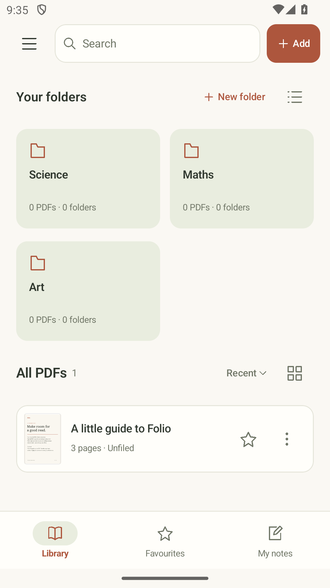

<div align="center">

# Folio

**Your PDFs. Your shelves. Your reading space.**

A quiet, offline PDF library for Android. Add a document once, organise it into folders, and pick up where you left off.

[Download APK](https://github.com/coderakr/folio/releases/latest) · [Report an issue](https://github.com/coderakr/folio/issues) · [Build from source](#build-from-source)

**Android 9+ · Kotlin · Jetpack Compose · No account required**

</div>

<p align="center">
  
</p>
<p align="center"><em>The original Folio theme, with example subject folders and the included starter guide.</em></p>

## A home for your reading

| | What you can do |
| --- | --- |
| **Build your library** | Add PDFs, create nested folders, or import an entire directory with its subfolders. |
| **Find things quickly** | Search titles, save favourites, sort your books, and switch between grid and list views with Small, Medium, or Large tiles. |
| **Read your way** | Swipe between pages or scroll continuously. Resume your last page, use bookmarks, or jump with the page slider. |
| **Focus on the page** | Read full screen, rotate pages, and double-tap to zoom into the area you want to read. |
| **Keep your thoughts** | Select and copy text, highlight words across lines, draw, and attach notes. Changes save automatically inside Folio. |
| **Make it yours** | Choose six themes, light or dark mode, and a separate PDF page background. |

Folio keeps its own copy of imported PDFs, so moving the original download does not break your library. Open or share PDFs from WhatsApp, Files, email, and other apps directly into Folio.

## Start reading

1. Install the APK from [GitHub Releases](https://github.com/coderakr/folio/releases).
2. Tap **Add** to select one or more PDFs. The included three-page Folio guide is ready to try immediately.
3. Open **☰ → Import folder** to bring in a directory, or choose **New folder** to create a section. Open a folder first to add PDFs and subfolders inside it.
4. Tap a PDF to read. Use its options menu to rename it, move it, or remove it from Folio.

The bottom bar takes you to **Library**, **Favourites**, and **My notes**. The sidebar holds themes, dark mode, PDF backgrounds, grid size, and folder actions.

### Reading controls

- **Page navigation:** swipe left/right in page view, or choose **Reader options → Scroll pages** for continuous reading. The page counter lets you enter an exact page number; the thin slider jumps through the document outside full screen.
- **Full screen:** tap the expand icon. Double-tap a page to zoom to 2.5× around that spot; double-tap again to reset. Drag to pan, or pinch to adjust zoom up to 4×. In scroll mode, reset zoom before scrolling to another page.
- **Less clutter:** full screen has no slider or “Fit page” button. Tap the page centre to toggle the page-navigation controls. Rotate using the top-right control; exit with the collapse icon or Android Back.
- **Text selection:** long-press a word and drag to extend the selection, then choose **Copy** or **Highlight**. This also works in continuous reading and full screen.
- **Highlight tool:** tap a word for a quick highlight, or drag forward or backward across multiple lines. Text highlights snap to words and save the selected passage in **My notes**. Scanned pages without a text layer support area highlights instead.
- **Annotations:** choose Highlight, Draw, or Note. Existing notes can be tapped to edit. Selecting an annotation tool in scroll mode opens the current page in page view.

Rotation and double-tap zoom work together at 0°, 90°, 180°, and 270°. Changing pages, rotation, or full-screen state resets zoom. Outside full screen, **Fit page** remains available when zoomed.

### Library grid size

Choose **☰ → Grid size → Small, Medium, or Large**. Small fits more items on each row; Large gives covers and folders more room. The preference is saved and applies to folder and PDF grids throughout the library, including subfolders and favourites. Grid columns adapt to the available width and text-size settings. List view stays available through each section’s view button.

### Themes and PDF backgrounds

Choose **☰ → Themes** for **Folio**, **Ocean**, **Forest**, **Lavender**, **Rose**, or **Black**. Selecting Black enables dark mode with a pure-black app background; the dark-mode switch can return it to a neutral light palette.

Choose **☰ → PDF page background** or **Reader options → PDF page background**:

| Background | Effect |
| --- | --- |
| **Original PDF** — default | Preserves the document’s own colours. Best for photos and diagrams. |
| **Follow app theme** | Adapts page colours to your selected theme and light/dark mode. |
| **Sepia** | Warm paper with dark text. |
| **Black** | Black paper with light text. |

Preferences are saved for future sessions. Background tints also affect images, but do not change annotation colours or rewrite the PDF.

## Your files stay on your device

No account, server, analytics, or network permission is required. PDFs and annotations live in the app’s private storage.

- Annotations are saved as overlays inside Folio; no extra PDF is generated. Other PDF readers will not see those annotations.
- Text selection uses the PDF’s embedded text layer. Scans, inaccessible text, or fonts without usable character mappings may only support area highlights; OCR is not included. Password-protected PDFs must be unlocked before import. Each imported file can be up to 300 MB.
- Deleting a folder keeps its PDFs and annotations in **All PDFs**. Removing a PDF from Folio leaves its original source file untouched.
- Uninstalling Folio or clearing app data can remove your library and notes. Keep the original PDFs as a backup.

## Build from source

Use Android Studio or a terminal with **JDK 21** and the **Android SDK 37.0** installed. Set the SDK path in `local.properties`; the Gradle wrapper is included.

```sh
./gradlew :app:assembleDebug
adb install -r app/build/outputs/apk/debug/app-debug.apk
```

The app supports **Android 9 / API 28 and newer**. The debug APK is created at `app/build/outputs/apk/debug/app-debug.apk`.

### Architecture

Folio is a native, single-activity app built with **Kotlin**, **Jetpack Compose**, and **Material 3**. `LibraryModel` manages UI state and serialises saves; `LibraryStore` imports private PDF copies and writes library metadata with Android’s `AtomicFile`. Android’s `PdfRenderer` renders pages on demand. [PDFBox-Android](https://github.com/TomRoush/PdfBox-Android) extracts word positions off the main thread with a bounded page cache; Compose handles text selection and draws annotations over the page. Word rectangles and selected text are saved alongside legacy area highlights without rewriting PDF bytes. Continuous reading uses a lazy list of pages. No backend is needed.

### Checks

```sh
./gradlew :app:testDebugUnitTest :app:assembleDebug :app:lintDebug
# Requires a connected Android device or emulator:
./gradlew :app:connectedDebugAndroidTest
```

Tests cover imports and nested folders, grid sizing and saved preferences, text selection gestures, text bounds on cropped/rotated PDFs, annotation persistence, unchanged PDF bytes, external-app intents, page navigation, rotation, backgrounds, and full-screen zoom in both reading modes.

## Publish a release

[GitHub Actions](.github/workflows/release.yml) runs **only when you push a tag matching `v*`**. Branch pushes do not start it, and there is no manual-run trigger. The workflow checks, signs, and publishes an APK with a SHA-256 checksum to [Releases](https://github.com/coderakr/folio/releases).

<details>
<summary><strong>One-time setup: configure release signing</strong></summary>

Keep a permanent signing key outside the repository. Reuse the existing key if you have already distributed a signed release. Otherwise, create one; this command prompts for a password:

```sh
mkdir -p "$HOME/.android/folio-signing"
keytool -genkeypair -v -keystore "$HOME/.android/folio-signing/folio-release.jks" \
  -alias folio -keyalg RSA -keysize 3072 -validity 10000
```

Add these **repository secrets** under **Settings → Secrets and variables → Actions**:

| Secret | Value |
| --- | --- |
| `ANDROID_KEYSTORE_BASE64` | Base64-encoded keystore contents |
| `ANDROID_KEYSTORE_PASSWORD` | Keystore password |
| `ANDROID_KEY_ALIAS` | Signing alias, such as `folio` |
| `ANDROID_KEY_PASSWORD` | Key password; usually the keystore password for PKCS12 |

Prepare the Base64 value locally, then paste the file’s contents into the secret:

```sh
base64 < "$HOME/.android/folio-signing/folio-release.jks" | tr -d '\n' > "$HOME/.android/folio-signing/folio-release.base64"
```

Or upload it using an authenticated GitHub CLI:

```sh
base64 < "$HOME/.android/folio-signing/folio-release.jks" | tr -d '\n' | gh secret set ANDROID_KEYSTORE_BASE64
```

Back up the key and passwords securely. Future updates must use the same signing key. A debug APK uses a different certificate and cannot be directly updated by a release APK; uninstalling it can remove its PDFs and notes.

The workflow publishes with the built-in `GITHUB_TOKEN`; no personal access token is needed. Repository policy must allow the publishing job’s `contents: write` permission.

</details>

Set `versionName` and increase `versionCode` in [app/build.gradle.kts](app/build.gradle.kts). Commit the app and workflow changes **before creating the tag**. The current version is **1.10** (`versionCode = 11`):

```sh
git push origin HEAD
git tag v1.10
git push origin v1.10
```

The tag must match `versionName`. A successful run publishes `folio-v1.10.apk` and `folio-v1.10.apk.sha256`. Download both and verify with:

```sh
sha256sum --check folio-v1.10.apk.sha256
```

A retry can finish an interrupted draft release; published downloads are left unchanged. Use a new version and tag for subsequent updates. Signed APKs are also available as Actions artifacts for 14 days.

<details>
<summary><strong>Troubleshooting</strong></summary>

- **No workflow run:** push a new version tag, not just `main`. The tagged commit must include the workflow. Pushing an existing, unchanged tag does not start another run.
- **Missing signing secrets:** add all four repository secrets listed above, then re-run the failed job. Local debug builds do not require signing secrets.
- **Tag/version mismatch:** make sure the tagged commit’s `versionName` matches the tag. Keep published tags unchanged.
- **A workflow fix is not picked up:** re-running an old job uses its old workflow. Include the fix in a new version commit and push its matching tag.
- **Folder picker restrictions:** Android may prevent choosing storage roots or Downloads itself. Choose a subfolder. Imports include PDFs and nested folders; non-PDF files are ignored. Stopping an import keeps completed copies.
- **Folio missing from “Open with”:** if the sending app uses its own viewer or another viewer is the default, use **Share → Folio**. The sender must provide a readable PDF attachment.

Local release builds are unsigned unless `ANDROID_KEYSTORE_PATH`, `ANDROID_KEYSTORE_PASSWORD`, `ANDROID_KEY_ALIAS`, and `ANDROID_KEY_PASSWORD` are set. Use `--no-configuration-cache` when building with signing credentials.

</details>
